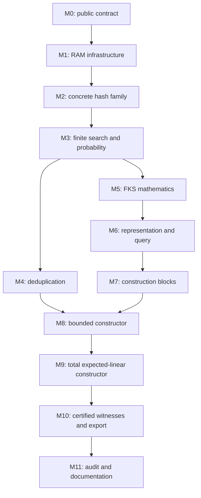

# Plan: a modular, executable proof of static perfect hashing

This is an implementation roadmap, not a claim that the proposed hashing theorems already exist in this repository. It is based on an inspection of the current word-RAM library and `~/code/personal_agent/word_ram_stack`, including its `PerfectHash/`, `FKS/Linear/`, and generic retry proofs.

The target is a **fixed pair of finite RAM programs**: preprocessing builds a static membership dictionary from an array that may contain repetitions; query decides membership for every word. The intended final bounds are expected `O(N+1)` preprocessing instructions, worst-case `O(1)` query instructions, `O(d+1)` retained dictionary words, and `O(N+1)` peak ordinary memory, where `N` is the input length and `d` is the number of distinct words. All constants, machine operations, randomness assumptions, memory conditions, and quantifier order must be explicit.

The recommended route is two-level FKS hashing, a separate verified deduplication pass, a reusable collision-bounded hash interface, and concrete program witnesses packaged with proofs. For full-width keys, use multiply-shift hashing with an explicitly specified logical-right-shift instruction. Preserve the current finite random-memory semantics; obtain a total constructor by combining capped random retries with deterministic seed enumeration. These are proposed design choices to settle in milestone M0, not changes made by this plan.

## 1. What the existing code establishes, and what needs redesign

### Current repository

The existing foundations are appropriate and should remain authoritative:

| Existing component | Use in the new development |
| --- | --- |
| [Words](../WordRam/Word.lean), [instructions](../WordRam/Program.lean), [machine](../WordRam/Machine.lean) | `BitVec` words, wrapping arithmetic, finite instruction arrays, explicit memory accesses. |
| [Execution](../WordRam/Execution.lean), [properties](../WordRam/Properties.lean) | `Steps`, `TerminatesIn`, exact instruction accounting, composition, framing, random-read agreement, and resource observations. |
| [Random memory](../WordRam/Random.lean) | Uniform law on an immutable finite random memory, independence at distinct addresses, and conditional uniformity of a fresh cell. |
| [Checks](../Checks.lean) | Audits standard proof axioms separately from executable definitions, which must have no axiom dependencies. |
| [Machine reference](word-ram.md) | Existing statement of the model, including unit-cost multiplication/remainder and the distinction between RAM cost and interpreter runtime. |

The project pins Lean 4.24.0 and Mathlib commit `f897ebcf72cd16f89ab4577d0c826cd14afaafc7`. Use those local sources when selecting APIs. The current probability interface is about bounded executions; it does not yet define or prove expected time to successful termination. The initial instruction set had neither division nor shifts; M1 now supplies the frozen logical-right-shift instruction. M1 supplies reusable memory-region assertions, verified array loops, and code relocation alongside `Steps.trans`. Hashing-specific refinements remain later milestones.

### Reference implementation

Useful ideas are already present in the reference:

| Reference files | Idea to retain |
| --- | --- |
| [`PerfectHash/Family.lean`](../../personal_agent/word_ram_stack/PerfectHash/Family.lean), [`Probability.lean`](../../personal_agent/word_ram_stack/PerfectHash/Probability.lean) | Separate collision mathematics; account for bias when uniform words are reduced modulo a prime. |
| [`PerfectHash/Specification.lean`](../../personal_agent/word_ram_stack/PerfectHash/Specification.lean) | Uniform existential statement and an explicit `VerifiedPerfectHash` value containing programs and a correctness proof. |
| [`FKS/Linear/Grouping.lean`](../../personal_agent/word_ram_stack/FKS/Linear/Grouping.lean) | Group into linked bucket lists in one pass instead of rescanning the input separately for each bucket. |
| [`FKS/Linear/Layout.lean`](../../personal_agent/word_ram_stack/FKS/Linear/Layout.lean), [`Parameters.lean`](../../personal_agent/word_ram_stack/FKS/Linear/Parameters.lean) | Packed secondary tables, disjointness proofs, and explicit address/arithmetic assumptions. |
| [`FKS/Linear/Expected.lean`](../../personal_agent/word_ram_stack/FKS/Linear/Expected.lean) | Charge work by bucket size; sum per-stage costs rather than multiplying every retry by the largest possible bucket. |
| [`FKS/Linear/Specification.lean`](../../personal_agent/word_ram_stack/FKS/Linear/Specification.lean), [`Interface.lean`](../../personal_agent/word_ram_stack/FKS/Linear/Interface.lean) | Relate actual executed instructions, including unsuccessful prefixes, to the abstract retry analysis. |
| [`WordRam/StagedRetry.lean`](../../personal_agent/word_ram_stack/WordRam/StagedRetry.lean) | A generic finite-expectation drift argument, independent of hashing. |

The reference's linear construction proves bounds including `14 + 6208*(n+1)` expected executed instructions, `512*(n+1)` reserved workspace words, and at most 42 query instructions. Those constants describe its own machine and programs; they are not proposed bounds for this repository.

There are important differences to address:

1. **Duplicates are outside the reference Lean constructor's contract.** Its probability theorems require injective input keys. Deduplication in a Rust wrapper does not establish a Lean theorem for arbitrary repeated input. Counting occurrences in FKS bucket energies also fails: `N` copies of one key give energy `N²` for every root hash.
2. **The stored-key universe is restricted.** Its affine family assumes keys below a supplied prime `p`, `16*(n+1)² ≤ p`, and `p² < 2^w`. Accepting every word as a query and rejecting words above `p` is useful, but does not allow every word to be stored.
3. **Its randomness model differs.** A `.random` instruction consumes a word from an external tape. Here `.rload` reads a named cell of a fixed finite memory. Rereading a cell cannot supply a new independent sample.
4. **Its strongest runtime result is formulated over finite tape prefixes.** A failure bound tending to zero as the available tape length grows is not automatically a theorem about this repository's fixed finite random memory.
5. **Its code organization carries historical costs.** Large numerical PC tables, inherited code fragments, separate interpreter variants, and FKS modules importing earlier concrete specifications complicate reuse. Port the mathematical ideas and local proof patterns, not the whole dependency graph or instruction lists.
6. **Its empty-slot encoding uses the restricted universe.** The prime can serve as a sentinel because stored keys are smaller. A dictionary over every `Word w` needs an occupancy flag or another proved encoding; no word value is globally available as a sentinel.

## 2. The public contract to aim for

### Inputs, semantics, and uniformity

Use an input array/list `xs : List (Word w)` in the specification, with:

```text
N = xs.length
S = xs.toFinset
d = S.card
contains(xs, q) ↔ q ∈ xs ↔ q ∈ S
```

`S` and `d` are specification objects. Preprocessing must discover the distinct keys and their count by executing RAM instructions. It must not receive an uncharged deduplicated list, a perfect seed, or proof-derived advice.

Choose a fixed register count, two programs, calling conventions, and resource constants **before** quantifying over width, input length, key values, memory placement, and random memory:

```text
∃ R, ∃ preprocess query : WordRam.Program R, ∃ constants,
  ∀ w xs layout initialRegisters initialMemory,
    admissible inputs →
      total preprocessing correctness and resource bounds ∧
      correctness and constant cost of every subsequent query
```

The final existential theorem must cover the complete two-level constructor, not just a hash-function existence lemma or the single-level intermediate result. Programs must be independent of `w`, `N`, `xs`, and the chosen random memory. Machine width may be supplied as a checked calling-convention parameter when the program needs it; it must not be hidden in a width-specialized instruction array.

The dictionary is static membership only. Input order and repetition do not affect answers, although they may affect the physical table. A successful query returns exactly `0` or `1`, preserves the entire ordinary memory, uses no random reads, and is correct for **all** `q : Word w`. It compares the actual stored key after hashing; an injective placement on `S` alone does not prevent false positives for nonmembers.

State the two quantifications separately: deterministic correctness and termination hold for **every** `rho`; the preprocessing expectation averages those executions under `randomMemoryLaw w`. For each completed table, query correctness holds simultaneously for every query, including queries chosen after inspecting previous answers or the table. The expected construction bound concerns a fixed input independent of the random memory.

### Resource statements

| Quantity | Final target | Accounting convention |
| --- | --- | --- |
| Preprocessing time | `E[T] ≤ Cpre*(N+1)` | Actual instructions through successful halt, including all failed trials, deduplication, initialization, and fallback. |
| Worst-case preprocessing time | An explicit finite bound; proposed shape `Cworst*((N+1)² + 2^w*(d+1))` | Deliberately large because of exhaustive fallback. Prove it, rather than presenting it as an expected bound. |
| Query time | `Tquery ≤ Cquery` | Includes seed loads, hash evaluation, occupancy/key checks, branches, and halt. Constants independent of `w`, `N`, `d`, and `q`. |
| Retained dictionary | `usedWords ≤ CD*(d+1)` | Header, directory, all stored seeds, occupancy markers, and stored keys. |
| Construction workspace | `workspaceWords ≤ CW*(N+1)` | Deduplication directory/nodes, compact distinct array, FKS grouping, and temporary control state. |
| Peak ordinary memory | `N + workspaceWords + dictionaryCapacity + R`, with an explicit `O(N+1)` bound | Include the original input; permit documented workspace reuse. |
| Random reads | Expected `O(d+1)`; bounded maximum `O(w*(d+1))` | Count actual reads separately from the reserved address span. |
| Random bits exposed | `w` times the number of distinct random cells read | Use the existing definition; this is not necessarily the entropy of the transformed hash seed. |
| Random-memory reservation | Explicit `O(w*(N+1))` sufficient capacity, or tighter `O(w*(d+1))` after deduplication | Separate resource from ordinary mutable workspace. All reserved/read addresses must fit. |
| Code/register size | Explicit constants | Do not hide input-dependent code, registers, or metadata. |

Distinguish a caller's `O(N)` capacity reservation from the `O(d)` retained prefix. The output descriptor should report the retained extent; correctness must depend only on that extent so the remaining workspace can be reused. Query must work after the original input and scratch memory are overwritten.

First prove numerical inequalities. Derive asymptotic corollaries afterward, with constants uniform across admissible widths and sizes. Fixed-width finite-domain big-O statements alone are not informative.

### Assumption ledger

Each public theorem should expose these assumptions through small named predicates, with their fields documented:

| Assumption | Intended treatment |
| --- | --- |
| `w ≥ 1` and all stored/query keys are `Word w` | Full word domain in the final theorem. Width-zero behavior may remain in machine semantics without being in the dictionary contract. |
| Valid input encoding and calling convention | Input address, occurrence count `N`, output/scratch addresses and capacities, random region, and the correct width value are available as words. Other scratch registers are arbitrary. |
| Ordinary-memory fit and separation | Input/output/scratch regions and all used offsets are representable and appropriately disjoint. Use natural-number endpoint inequalities before converting to words. |
| Arithmetic fit | Counters, directory sizes, offsets, and intermediate sizes fit; multiplication in the hash deliberately wraps. Prove these separately. |
| Dirty initial memory | No implicit zero-filled heap. Charge clearing every directory/occupancy cell that requires initialization. |
| Randomness | `rho` follows `WordRam.randomMemoryLaw w`; input, initial memory, and initial register values are fixed independently of `rho`. Reuse the same `rho` throughout a construction. |
| Random-address capacity | An explicit sufficient bound for all reserved blocks, including failed attempts. Guard against cursor wrap. |
| Instruction costs | Existing RAM costs, plus the proposed unit-cost logical right shift for the full-word implementation. State this extension clearly. |
| Query precondition | A valid representation produced by preprocessing, or an independently proved equivalent representation. Do not assume arbitrary malformed tables are valid dictionaries. |
| Allocation policy | Caller supplies ordinary-memory regions; allocation from an OS is outside the RAM theorem. Internal layout calculation and initialization are charged. |
| Optional affine backend | Prime `p`, restricted keys, seed-reduction bias, and nonoverflow conditions remain explicit only in that backend's theorem. Prime discovery is charged if later added. |

The final constants and layout must produce a **nonvacuous admissibility corollary**: for every finite input of `k`-bit keys, sufficiently large machine width admits embeddings, disjoint storage, and enough random addresses. Also give explicit sufficient inequalities for a fixed width, so the cost of the finite random-memory reservation is visible.

## 3. Hash families as an independent library

Use a small mathematical interface, separate from its RAM realization. Parameterize it by key type, admissible range sizes, a seed type, an executable evaluator, and a seed distribution. For `m > 0`, require the collision inequality

```text
x ≠ y  ⇒  Pr_seed[eval seed x = eval seed y] ≤ c / m
```

for a fixed positive constant `c`. Do not require pairwise-independent outputs: the FKS argument only needs a pairwise collision bound. In particular, multiply-shift does not make the hash of zero uniformly distributed.

Keep these obligations distinct:

1. `eval` lands in the specified range and is computable.
2. The mathematical seed law satisfies the collision bound.
3. A concrete sampler fed uniform raw words realizes that law, or satisfies an explicitly proved bounded-bias variant.
4. The seed has a fixed-size word encoding and the RAM evaluator implements `eval` in a constant number of instructions.
5. A computable finite enumeration covers the valid seeds, with a bound on its length and RAM cost. This is needed by the total-construction fallback.

General probability statements may use `PMF`/finite expectations and classical reasoning. Actual seed generation, evaluation, enumeration, serialization, and programs must remain executable. Use the pinned Mathlib APIs and bridge to the existing `WordRam.probability`; do not create an unrelated second probability semantics merely to reproduce the reference's integer-count proofs.

### Recommended concrete family: multiply-shift

For `m = 2^ell`, a uniformly chosen odd `w`-bit word `a`, and `ell ≤ w`, use

```text
h(a, ell, x) = ((a * x) mod 2^w) >>> (w - ell).
```

The family has collision bound `2/m`. Its classical proof is in Dietzfelbinger–Hagerup–Katajainen–Penttonen, Lemma 2.4; the use of a wrapping product is intentional. [Original paper](https://cglab.ca/~morin/teaching/484/notes/universal.pdf)

One uniform raw word `r` produces a uniform odd seed via `r - (r % 2) + 1`; prove the two-to-one fibers. Enumerate odd seeds directly. Store the shift amount with each seed so query performs no logarithm calculation. The family, its seed distribution, its encoding, and its RAM evaluator should be separate modules. Thorup's notes provide a readable proof and distinguish this collision guarantee from stronger independence properties. [Sections 2.3 and 3](https://arxiv.org/pdf/1504.06804)

M1 now provides the required logical-right-shift instruction, including full-count and oversized-count semantics, and rechecks all machine proofs. A software emulation is another option, but its cost must be charged; an `O(w)` evaluator cannot support the desired query bound. Do not silently assume mathematical division is already a unit-cost instruction.

An affine-mod-prime backend is a useful optional reference instance because much of its mathematics exists nearby. It should not become a mandatory detour or weaken the final full-word theorem. If used, retain its residue-bias proof and restriction on stored keys.

## 4. Handling repeated input without losing the bounds

Use a separate `Dedup` module with this specification:

```text
output ys has no duplicates
∀ q, q ∈ ys ↔ q ∈ xs
ys.length = d ≤ N
input and unrelated memory are preserved
```

A simple quadratic implementation can establish the first end-to-end correctness milestone. The final implementation should use temporary chaining:

1. Allocate and clear `m0 = nextPow2(max 1 N)` bucket heads.
2. Choose one independent hash seed.
3. For each input occurrence, search its chain by full-word equality.
4. Insert a node and append to the compact distinct array only if the key is absent.
5. Return the array length as the computed `d`.

Chains contain **distinct keys**, not all occurrences. For occurrence `x_i`, let `D_i` be the set of distinct keys in the preceding input prefix. Its number of key comparisons is bounded by

```text
1 + Σ (y ∈ D_i, y ≠ x_i), indicator[h(y) = h(x_i)].
```

The prefix sets are fixed by the input, even though the chain order depends on the seed. Thus the collision bound gives expected comparisons at most `1 + c*|D_i|/m0 ≤ 1+c`; summing over `N` occurrences proves expected `O(N+1)` time. This also covers very unbalanced multiplicities. Prove the actual traversal-cost bound before taking expectations.

The routine terminates correctly for every seed, with worst-case `O((N+1)²)` work and `O(N+1)` storage. Give it a random block disjoint from FKS construction. Its `O(N)` temporary directory is released after preprocessing, so it does not inflate the retained `O(d)` dictionary. The original paper also studies duplicate grouping, but the proposed membership-only chaining proof above is a smaller, independently verifiable obligation. [Original paper, introduction](https://cglab.ca/~morin/teaching/484/notes/universal.pdf)

Avoid a circular dependency: deduplication must use a simple chained table, not assume the final perfect dictionary already exists. Sorting plus adjacent compression is a valid alternative milestone, with its actual sorting cost stated; `List.eraseDups` is not automatically an efficient RAM algorithm.

## 5. The FKS proof, with arithmetic and cost obligations

The classical construction gives a static dictionary with linear storage and constant worst-case membership lookup. The plan uses its two-level structure rather than pursuing minimal perfect hashing or succinct storage. [Fredman–Komlós–Szemerédi](https://www.cs.umd.edu/~gasarch/BLOGPAPERS/FKS.pdf)

After deduplication, work with `d` distinct keys. Handle `d = 0` separately with a constant-size empty header. For `d > 0`, set `m = nextPow2 d`, so `d ≤ m < 2d`.

### Root stage

Let `b_j` be the number of keys in bucket `j` and `E = Σ_j b_j²`. Prove the counting identity

```text
E = d + 2 * number of colliding unordered pairs.
```

With collision constant `c`, `E_seed[E] ≤ d + c*d*(d-1)/m ≤ (1+c)*d`. Accept a root seed when `E ≤ 2*(1+c)*d`; Markov gives rejection probability at most `1/2`. For multiply-shift, the threshold is `6d`.

Group the compact distinct input into bucket lists in one pass. A root trial costs `O(d+m)`. On rejection, reset only the root directory and grouping workspace. Charge all clearing and all discarded work.

**Reject safely before overflow.** A bad root may have energy `d²`, even when only `O(d)` storage fits. Do not assume `d² < 2^w` just to sum squares. Maintain a threshold-bounded energy accumulator and use the increment `(b+1)²-b² = 2b+1`, checking the remaining allowance before addition. Prove equivalence to the mathematical acceptance test, including early rejection. Only accepted bucket counts reach secondary-size calculations.

### Secondary stages

For a bucket of size `b ≥ 2`, choose `q = nextPow2(c*b²)`. A union bound gives

```text
Pr[any collision] ≤ c * binom(b,2) / q < 1/2.
```

For `c=2`, `q = nextPow2(2*b²) < 4*b²`. Empty buckets have no table; singleton buckets can store their one key directly. A child trial clears its own occupancy area and inserts its `b` keys, rejecting on collision. It costs `O(q+b+1)` and retries only that child. Successful siblings remain untouched.

For an accepted multiply-shift root, `Σ b_j² ≤ 6d`, so the total number of slots, counting singleton slots, is at most `24d`. With two words per slot and four words per directory entry, a candidate retained-space estimate is `headerWords + 56d`; this is a design estimate to verify against the chosen layout, not an established constant. The same sum bounds total child work per round of attempts.

The root bound also makes each size calculation small: `2*b² ≤ 12d`, and rounding gives less than `24d`. Derive representability from the final linear-capacity assumptions. There should be no unnecessary global `d²`-fits assumption. Prove and charge next-power-of-two calculation; a doubling loop is sufficient if its total cost is absorbed by the corresponding table/grouping work. No uncharged `log2` instruction is needed.

### Representation and query

Use a representation predicate independent of construction history. It states that the header and directory are valid, table regions are disjoint and inside the retained extent, seeds decode correctly, each occupied slot contains the right key, and every input-set member has a slot. Store explicit occupancy information; zero and the maximum word must remain ordinary valid keys.

Prove query before the full constructor: decode the root, select the bucket, handle empty/singleton cases, evaluate the secondary hash, and compare the occupied slot's key. Prove absence of writes/random reads and independence from memory outside the representation. Construction then needs only to establish this predicate.

## 6. Finite random memory and total expected preprocessing time

This is a central proof obligation, not an implementation detail.

For fixed `w`, the current random memory has only `2^w` cells and finitely many possible complete images. Every image has positive probability. If a program diverges on even one image, an extended stopping-time expectation is infinite. Reading the same cells again does not fix this. Consequently, an unlimited retry argument based on indefinitely fresh samples cannot establish the desired theorem in the current model.

### Recommended solution: capped sampling with exhaustive fallback

First prove a generic finite-search theorem. Suppose a decidable trial has failure probability at most `1/2`, a computable enumeration of at most `H` seeds contains a successful candidate, and each trial costs at most `B` instructions. Try at most `r` independent random seeds; if all fail, enumerate the seeds until success. Then:

```text
Pr[fallback] ≤ 2^(-r)
E[random attempts] ≤ 2
E[trial work] ≤ 2*B + 2^(-r)*H*B
```

Account separately for initialization, retry bookkeeping, and finishing; include their per-attempt parts in `B`. Enumeration must be an actual RAM loop with constant-size state, not a materialized list of every seed. The positive success probability supplies the mathematical existence needed to prove that enumeration terminates; it does not choose the runtime seed.

For multiply-shift, there are `H = 2^(w-1)` odd seeds. Taking `r = w` gives fallback expected work at most `B/2`, so `3B` is a convenient conservative allowance. The loop enumerates odd words without a counter holding `2^w`: process the last odd word explicitly and prove success occurs within the enumeration. This is a proposed proof strategy, with the generic and RAM lemmas still to be written.

Apply this theorem to the root and separately to each nontrivial child, conditioning on the already constructed state. The accepted root bounds the sum of all child trial costs. Together with deduplication, this yields the intended total expected `O(N+1)` preprocessing theorem. Every random-memory image terminates correctly; randomness affects only cost and the chosen representation.

### A simple random-address discipline

Prefer deterministic disjoint blocks over a sophisticated adaptive random allocator in the first implementation:

```text
dedup seed:          randomBase
root block:          randomBase + 1 ... randomBase + w
child j block:       starts at randomBase + 1 + w*(j+1), length w
reserved words:      1 + w*(m+1)
```

Empty/singleton children need not read their blocks. Prove that addresses within an attempted stage are distinct and that its block is disjoint from all preceding stages. The unused block remains uniform even though bucket membership and child table size depend on the root seed. The existing `conditional_fresh_cell` is a building block, not already this complete conditional-history theorem.

A sufficient caller-visible bound uses `mN = nextPow2(max 1 N)` and

```text
randomBase + 1 + w*(mN+1) < 2^w.
```

This deliberately conservative strict inequality leaves a representable endpoint. The exact condition can be tightened later. It is stronger than ordinary `O(N)` memory fit and must appear in the main theorem. Reservation is `O(w*(N+1))` random words, while expected actual reads are at most `1 + 2*(d+1)` for the proposed one-word seed sampler; fallback reads no random cells. The total fallback probability is at most `(m+1)*2^(-w)` by a union bound. Do not confuse any of these three statements.

The sufficient worst-case time shape is `O((N+1)² + 2^w*(d+1))`: quadratic deduplication in the worst case, followed by bounded random trials and finite enumeration at each stage. These bounds use mathematical natural numbers and need not fit in a machine register. Only the counters actually stored by the program need word-fit proofs.

### Intermediate and alternative guarantees

A bounded constructor that halts with either success or an explicit retry-budget status is a useful milestone. On success it must be exact; its failure probability and all work on failures must be bounded. The status is a program output, not interpreter fuel exhaustion or an invalid-PC fault. Such a constructor alone does not fulfill the final always-successful preprocessing contract.

An unbounded independent random stream is another legitimate model, but requires an explicitly separate semantics and a refinement/equivalence theorem for bounded prefixes. Likewise, finite-prefix expectation bounds plus a tail tending to zero require an actual limit argument to obtain an infinite-stream theorem. Neither is needed for the recommended finite-memory fallback route. Restarting the whole program with freshly sampled random memory is an external operation unless separately modeled and charged.

## 7. Module boundaries and proof interfaces

Organize by reusable responsibility and dependency direction. The following are proposed locations; add files when their responsibilities become concrete rather than creating an empty framework in advance.

| Layer / proposed modules | Responsibility | Must not depend on |
| --- | --- | --- |
| `WordRam/Regions.lean`, `WordRam/Blocks.lean` | Region assertions, local block contracts, footprints, frame and sequential composition. | Hashing or a particular algorithm. |
| `WordRam/Assembly.lean` | Small symbolic-label assembler, relocation, fetch/control-flow theorems. | FKS register assignments or layout. |
| `WordRam/Arrays.lean`, `WordRam/LinkedLists.lean` | Input arrays, clear/copy/traverse loops, compact output, linked nodes and disjointness. | Probability or perfect hashing. |
| `Probability/Finite.lean`, `Probability/Retry.lean`, `Probability/FiniteSearch.lean` | Finite sums/PMFs, capped retry and staged costs, exhaustive fallback expectation. | RAM programs or FKS. |
| `WordRam/RandomBlocks.lean` | Translate disjoint random-memory regions into the seed laws used by the abstract probability proofs. | FKS acceptance thresholds. |
| `Hashing/Family.lean`, `Hashing/Collisions.lean` | Collision-bounded families, pair counting, bucket energy, existence of good seeds. | Memory layout or assembly. |
| `Hashing/MultiplyShift.lean`, `Hashing/MultiplyShiftRam.lean` | Concrete arithmetic/sampling mathematics; separately, encoding and constant-cost RAM realization. | Dictionary construction. |
| `Hashing/AffineModPrime.lean` (optional) | Restricted-universe family and residue-bias bounds. | FKS or a particular layout. |
| `Algorithms/Dedup/{Specification,Model,Program,Correctness,Bounds}.lean` | Repeated input to an executable compact distinct array. | Perfect hashing. |
| `DataStructures/StaticSet/Specification.lean` | Membership semantics, representations as an interface, input/output and cost contract. | FKS internals. |
| `DataStructures/PerfectHash/{Buckets,Layout,Representation}.lean` | FKS combinatorics, physical layout and implementation-specific representation. | Concrete preprocessing execution proofs. |
| `DataStructures/PerfectHash/Query/{Program,Correctness}.lean` | Query witness, exact semantics, constant cost, no writes/randomness. | Preprocessing invariants. |
| `DataStructures/PerfectHash/Build/{Model,Trial,Program,Invariant,Correctness,Bounds}.lean` | Abstract stage machine, executable trials, compilation/refinement, totality and expected cost. | Public existence theorem or extraction demos. |
| `DataStructures/PerfectHash/{Specification,Certified,Examples}.lean` | Assemble the public contract, concrete certified value, existential corollary, boundary examples. | Unproved backend behavior. |
| `PerfectHashChecks.lean`, `examples/`, `export/` as needed | Audit coverage, executable examples, serialization and external adapters. | These must not be imported to justify library proofs. |

Keep mathematical `Hashing` independent of `WordRam` except for concrete word-family modules; keep `MultiplyShiftRam` outside the imports used by pure FKS combinatorics. Keep ordinary machine imports free of probability where possible, as they are now. A reusable chained-table component may move out of `Dedup` once its second consumer exists.

The core proof boundaries should be small:

- **Hash realization:** encoded seed plus key → correct range value, with a constant instruction bound and explicit clobbered registers.
- **Trial:** a single seed → accepted/rejected status, representation invariant, frame, and an actual work bound. No probabilistic hypothesis needed for deterministic correctness.
- **Search:** the trial contract plus a seed law and enumeration → termination, failure/fallback probability, and expected total work.
- **Query:** valid representation → correct result and constant cost. No construction history or probability hypotheses.
- **End-to-end composition:** deduplication plus distinct-key construction → the repeated-input public contract.

Use named records for these contracts rather than long conjunctions whose proofs depend on chains such as `.2.2.2.1`. Keep ghost lists, sets, potentials, and proofs outside executable state. A small assembler should eliminate fragile manually numbered jumps; it must emit ordinary `Program R`, with instruction-level cost retained. Do not start by building a general-purpose compiler or a second RAM evaluator.

## 8. Milestones and completion criteria

### M0 — Freeze the theorem and model choices

**Dependencies:** none. **Main risk:** specifying an impressive but weaker or vacuous theorem.

**Implemented:** the [M0 contract](perfect-hashing-spec.md) records the frozen model choices and calling conventions. `DataStructures/StaticSet/Specification.lean` and `DataStructures/PerfectHash/{Admissibility,Specification}.lean` define the public target and prove explicit feasible layouts, including arbitrary repeated inputs embedded at every sufficiently large width. Boundary examples and axiom audits cover the new modules. This completes the specification milestone; it does not assert that the dictionary programs or their target bounds have been implemented.

Write the public semantic specification, the assumption ledger, and a sample theorem signature. Settle full-word keys, the proposed shift instruction, finite-memory fallback, input preservation, caller-supplied regions, and the `N`/`d` distinction. Define the meaning of retained space, peak workspace, random reservation, and actual reads. Give explicit admissible examples and a sufficiently-large-width lemma.

**Complete when:** a reviewer can read one specification and determine exactly what the two programs must accomplish, including duplicates, all-word queries, all-seed correctness, expected versus worst-case time, and every environmental assumption. Any restricted intermediate theorem has a visibly narrower name and contract.

### M1 — Add only the machine and proof infrastructure needed

**Implemented:** `shr` follows the frozen full-count semantics. `WordRam/Regions.lean`
extracts the unchanged M0 assertions; `Blocks.lean` adds composition and prefix
permissions; `Assembly.lean` adds symbolic labels and execution-preserving relocation;
`Arrays.lean` proves fill/clear, copy, and traversal with exact `7*n+2` instruction
counts, frames, and fitting access regions. Dirty-memory, empty-array, boundary,
partial-store, relocated-code, and shift-alias checks exercise the implementation.

**Dependencies:** M0. **Main risk:** infrastructure expansion obscuring the algorithm.

Add the chosen right-shift semantics and re-establish existing machine theorems. Build small region/array assertions, block contracts over `Steps`, and symbolic-label assembly with relocation. Prove clear/copy/traverse loops with exact or affine instruction bounds. Reserve a fixed, comfortable register set rather than optimizing register count prematurely.

**Complete when:** a small loop assembled with labels executes correctly, has a frame/footprint theorem and a charged cost, works over dirty memory, and handles boundary addresses without wrapping. Existing checks and axiom audits pass; old-instruction semantics are preserved.

### M2 — Prove and implement the hash family

**Implemented:** `Hashing` supplies the finite collision interface, a full-word
multiply-shift collision proof with constant two, exact two-to-one sampling and
random-cell law transfer, odd-seed enumeration, and fixed RAM evaluator/sampler
programs. The evaluator costs three instructions and the sampler four, including
halt; both have empty memory traces. See the [hashing reference](hashing.md).

**Dependencies:** M0; the RAM evaluator uses M1. **Main risk:** conflating arithmetic or distribution assumptions.

Define the mathematical collision interface and raw-word sampler interface. Prove multiply-shift's range, odd-seed law, collision bound, seed enumeration, and runtime encoding. Supply a fixed RAM evaluator and its constant-cost theorem. Isolate generic modular arithmetic and power-of-two rounding lemmas that have independent uses.

**Complete when:** a concrete family satisfies every mathematical and RAM obligation over all `Word w` keys. Small-width exhaustive checks exercise collisions, zero, maximum words, and edge shift amounts. There is no abstract unit-cost hash oracle left in this backend.

An affine backend is optional; do not block M3–M5 on implementing two families.

### M3 — Establish reusable probability and finite-search lemmas

**Implemented:** `Probability/{Finite,Retry,FiniteSearch}.lean` proves finite
averages, capped retries, total exhaustive fallback, and the `3B` word-budget
expectation. `WordRam/RandomBlocks.lean` transfers disjoint coordinates and
history-dependent stage bounds to the existing random-memory law. A concrete
predicate-search RAM program terminates on every image, including forced fallback,
with exact expectation `3+4/2^w ≤ 5` and a one-cell random reservation. See the
[finite-search reference](finite-search.md).

**Dependencies:** M0; concrete seed parameters from M2. **Main risk:** unjustified independence or expected-time claims.

Prove finite expectation/Markov/union-bound wrappers as needed, capped retry tails and expected attempts, sequential stage cost composition, and capped-random-plus-enumeration totality and expectation. Prove random-block law transfer using the existing random-memory semantics. Keep these results generic in the seed type and trial state.

**Complete when:** a toy predicate-search RAM program terminates for every memory image and satisfies a nontrivial expectation bound over `randomMemoryLaw`, with the fallback and random-address capacity fully charged. Repeated reads cannot satisfy a freshness hypothesis by accident.

### M4 — Verify deduplication as an independent algorithm

**Implemented:** `Algorithms/Dedup` supplies a fixed 57-instruction, 64-register
chaining program. It terminates for every random image, computes a compact distinct
array, preserves the input, uses `6*(N+1)` scratch words and exactly one random read,
and executes at most `67*(N+1)` instructions in expectation. The concrete proof
includes clearing dirty memory and all duplicate searches. See the
[deduplication reference](deduplication.md).

**Dependencies:** M1–M2; expectation and random-law transfer from M3. **Main risk:** an uncharged or quadratic normalization pass hidden in a linear claim.

Specify the input/compact-output relation. Prove totality, distinctness, membership equivalence, original-input preservation, and workspace bounds for chaining. Prove the prefix-set comparison bound from Section 4, then transfer it to expected executed instructions. Supply a quadratic baseline only if it meaningfully accelerates an earlier complete correctness result.

**Complete when:** the certified routine handles empty input, all-equal input, alternating duplicates, and arbitrary multiplicities, returns a computed distinct count, and has expected `O(N+1)` time and deterministic `O(N+1)` workspace. It is usable without importing perfect hashing.

### M5 — Prove FKS combinatorics and abstract construction

**Implemented:** bucket energy and unordered-pair identities, root/child rejection
bounds, `24d` total slots, and the frozen linear retained-space bound are proved.
An executable finite-search constructor and absorbing stage machine terminate for
every sample tuple, with expected abstract work at most `90*(d+1)`. The full-word
multiply-shift instance and conceptual stored-key membership theorem are supplied.
These are abstract work results; concrete RAM trial refinement remains M7–M9. See
the [FKS abstract-construction reference](fks-abstract.md).

**Dependencies:** M2–M3. **Main risk:** correct combinatorics attached to an inefficient realization.

Prove bucket partition/count lemmas, the energy identity, root acceptance probability, child collision probability, power-of-two rounding bounds, and total slots/metadata bounds. Define an executable abstract state machine with root trials and independent child retries; give completed stages absorbing behavior. Establish a stage-cost/potential proof using each child's own size.

**Complete when:** finite search builds an abstract valid dictionary, with expected linear construction work in `d`, linear retained space, and explicit constants in terms of the hash interface. Abstract operations are identified as obligations for later RAM refinement. No claim of RAM complexity is made solely from this milestone.

### M6 — Fix the representation and prove the query program

**Implemented:** `Layout` and `Representation` define packed, disjoint header,
directory, and occupancy/key regions with a retained-local representation.
`Query/{Program,Correctness}` supplies a fixed 33-instruction program and the frozen
`QuerySpec` at cost 33, including full-word membership, memory preservation, local
reads, and no randomness. Overwrite locality and repeated-query preservation are
proved independently of construction. See the
[query and representation reference](perfect-hashing-query.md).

**Dependencies:** M1–M2 and the layout bounds in M5. **Main risk:** sentinel errors, false positives, or retained dependence on scratch space.

Define the header, directory, seed encoding, table slots, occupancy markers, and packed offsets. Prove region disjointness and a local representation predicate. Implement/query it with a fixed program and prove constant instruction count, membership equivalence, memory preservation, no random reads, and invariance under changes outside the retained representation.

**Complete when:** query is correct for every word on every valid representation, independently of whether a constructor has been verified. Repeated queries preserve the representation. The input and construction workspace can be erased without changing answers.

### M7 — Verify individual construction blocks and trials

**Implemented:** deterministic RAM root and child trials, dirty-memory clearing,
overflow-safe energy guards, child allocation, and odd-seed enumeration. Concrete
acceptance predicates equal M5's predicates; actual instruction bounds include
rejected trials and local access policies. See the
[construction-trial reference](perfect-hashing-trials.md).

**Dependencies:** M1–M2, M5–M6. **Main risk:** costs or overflow on unsuccessful trials.

Verify root directory clearing, one-pass grouping, capped energy accumulation, accepted-root layout allocation, child clearing/insertion, and status reporting. Relate each block to the abstract state machine with costs and local reads/writes. Account for dirty memory, early rejection, partially built tables, and successful siblings on a child rejection. Include seed enumeration as a verified loop using the family interface.

**Complete when:** each block has a deterministic contract for every seed and every branch. Numeric bounds are derived before word conversions. A one-trial execution never claims a valid output table unless its acceptance condition holds, and rejected trials satisfy the same frame and capacity bounds.

### M8 — Assemble a bounded constructor and prove end-to-end refinement

**Implemented:** the fixed 231-instruction bounded constructor composes
deduplication, root retries, allocation, and child retries. Named simulation
relations establish the M6 query representation on success, with a truthful
budget-exhausted halt otherwise. Actual instruction bounds, sufficient fuel,
prefix access/frame/no-fault guarantees, and fresh bounded random reads are
proved. See the [bounded-constructor reference](perfect-hashing-bounded.md).

**Dependencies:** M3–M7. **Main risk:** an abstract proof that fails to describe actual code.

Compose the blocks into one fixed preprocessing program with explicit retry budgets and success/budget status. Establish a named simulation relation between concrete RAM states and the abstract construction state. Prove no invalid-PC fault, actual instruction and random-read accounting, frame/locality for every finite execution prefix, and establishment of the query representation on success.

Compose with deduplication to obtain the first complete repeated-input constructor/query theorem, with its bounded-construction failure status stated plainly. Prove an evaluator fuel bound sufficient to observe the program's own halt; do not equate that guard with actual expected cost.

**Complete when:** an executable, uniform program builds usable dictionaries from repeated input on successful runs, all outcomes are specified, and its finite success/failure guarantees concern `WordRam.run` under the current random-memory law. Query correctness is imported through the representation theorem, not reproved.

### M9 — Close totality and expected linear preprocessing

**Dependencies:** M3 and M7–M8. **Main risk:** stopping at a high-probability partial result.

Replace budget exhaustion by the verified exhaustive fallback, retaining the same trial blocks and query representation. Prove successful termination for every `rho`, a finite worst-case instruction bound, and expected time to that successful halt. Transfer conditional stage bounds to the complete run, including deduplication. Prove expected/max random reads, random-block capacity, exposed bits, and fallback probability. Prove final retained-space and peak-workspace inequalities.

**Complete when:** the full contract from Section 2 holds, with all constants named and derived from concrete code. The expected-time theorem counts bad random images and fallback work. No distinct-input assumption, unbounded random source, hidden prime restriction, or uncharged hash evaluator remains in the final full-word instance.

### M10 — Package explicit witnesses and extraction interfaces

**Dependencies:** M9; introduce the package type earlier if useful. **Main risk:** nonconstructive existence without executable programs.

Build a concrete certified value containing the two program arrays, entry conventions, and a proof of the public contract. Derive the existential theorem directly from that value. Export the exact instruction arrays and a documented dictionary format. Add a small Lean execution/demo entry point and round-trip validation for any serializer introduced.

**Complete when:** both programs can be projected and evaluated/exported without `Classical.choose`, and the exported objects are tied to the same program values appearing in the correctness theorem. The final user-facing theorem can be read without navigating the constructor's invariants.

### M11 — Audit, document, and exercise the completed development

**Dependencies:** M10; perform focused checks at every earlier milestone. **Main risk:** a theorem that is technically proved but hard to review or easy to misstate.

Extend audit coverage to every new namespace and to the executable definitions. Add the relevant Lake targets and check script integration. Update the machine reference, a dictionary reference, and the Lean Atlas file/description inventory; the current atlas explicitly lists modules, so new modules will not appear automatically. Record each public theorem's assumptions, constants, and dependency direction.

**Complete when:** kernel checking, axiom audits, selected executable boundary cases, and artifact checks pass. A reviewer can trace input encoding → construction theorem → representation → query result, and can locate the source of every runtime/space/randomness assumption.

### Dependency overview



The graph omits prerequisites already implied by a path. Mathematical portions of a milestone can begin earlier than its RAM implementation once their interfaces are fixed.

## 9. Making the existence proof useful for extraction

Use the following shape, with the actual contract and conventions filled in during M0. This is interface pseudocode, not currently compiling Lean:

```lean
structure DictionaryCode where
  registers : Nat
  preprocess : WordRam.Program registers
  query : WordRam.Program registers

-- Contract contains calling conventions, admissibility, total correctness,
-- representation locality, and uniform numerical resource bounds.
def DictionarySpec (code : DictionaryCode) : Prop := ...

structure CertifiedDictionary where
  code : DictionaryCode
  correct : DictionarySpec code

def fksCode : DictionaryCode := ...
theorem fksCode_correct : DictionarySpec fksCode := ...
def certifiedFKS : CertifiedDictionary := ⟨fksCode, fksCode_correct⟩

theorem dictionary_algorithms_exist : ∃ code, DictionarySpec code :=
  ⟨certifiedFKS.code, certifiedFKS.correct⟩
```

The implementation comes from explicit data in `Type`; the existential proposition is a convenient consequence. Do not try to recover executable code from an arbitrary `∃` proof in `Prop`, and do not define the programs by `Classical.choose`. Classical proofs of collision bounds or finite seed existence are fine: the program's actual search still executes an explicit sampler and enumeration loop.

Likewise, a successful dictionary should serialize only runtime data. Proof fields, the original set, original input list, and abstract histories must not be required for query evaluation. The representation predicate can refer to those ghost objects when proving correctness.

The first extraction target is the exact RAM instruction array and its calling convention. Running that array through the proved Lean interpreter already has a precise connection to the semantics. Translating it into C/Rust or running it in a faster emulator creates a separate backend-correctness obligation. Differential tests are useful evidence, but do not replace that obligation. An external random provider must preserve the address-indexed memory behavior; using a PRNG does not by itself establish the uniform-independent-memory hypothesis.

The total-construction route can reuse the existing finite expectation API: first prove a uniform sufficient fuel bound `F(w,N)` for all random images, then bound `expectedSteps preprocess F initial`. Because every such run has halted successfully, this is the expected cost to completion, not merely a truncated-prefix cost. `F` may be much larger than the actual or expected instruction count. Derive it from the all-image worst-case theorem using `d ≤ N`; no infinite-product probability space or noncomputable runtime choice is necessary.

## 10. Verification and review cases

Use proof obligations for general behavior and selected executable checks for integration failures. Do not attempt to replace probability theorems with sampling experiments.

| Case | What it is intended to expose |
| --- | --- |
| Empty input; singleton input | Header conventions, zero sizes, no accidental modulo-zero or invalid pointer use. |
| Every occurrence equal; heavily skewed repetition; interleaved duplicates | Deduplication correctness and the difference between `N` and `d`. |
| Zero and maximum word stored and queried | Invalid sentinel assumptions and full-domain hash behavior. |
| Nonmember hashing to an occupied slot | Missing full-key comparison / false positives. |
| All-distinct input; root rejection; child rejection | Correct acceptance predicates and retry locality. |
| Forced repeated bad seed values at different random addresses | Fallback path and the distinction between independent addresses and unequal sampled values. |
| Last allowed random attempt fails; zero-budget intermediate trial search | Exact budget semantics and no extra random read. |
| Tiny-width exhaustive seed enumeration | Collision theorem sanity, sampler fibers, fallback enumeration coverage. Use widths/capacities admissible for each tested component. |
| Large bad-root bucket counts | Threshold rejection before energy or size arithmetic wraps. |
| Arbitrary dirty output/scratch memory | Charged initialization and no dependence on pre-zeroed memory. |
| Regions near the last usable address | Endpoint conventions, index arithmetic, and random cursor fit. |
| Scratch and input overwritten after success | Retained dictionary locality and independence from construction history. |
| Repeated queries | Exact memory preservation and representation reuse. |
| Finite prefixes interrupted inside a trial | Frame/locality and truthful accounting before successful completion. |

Extend the existing axiom audit beyond the `WordRam` namespace. Public theorems may depend only on the project's accepted standard proof axioms (`propext`, `Quot.sound`, `Classical.choice`). Executable definitions must be checked separately for no axiom dependencies, and compiled/evaluated where appropriate. Keep `sorry`, project-specific axioms, and unchecked backend assumptions out of the certified path.

## 11. Scope and checkpoints

The highest-risk obligations are multiply-shift's modular collision proof, conditional random-block laws, concrete expected-cost refinement, and overflow-safe rejected trials. Prove small versions of these early. If a component is delayed, preserve the same abstract interface and state the resulting weaker theorem explicitly; do not silently change the final goal.

Useful review checkpoints are:

1. **After M0:** the theorem matches the intended dictionary and the assumptions are feasible.
2. **After M2–M3:** full-word constant-cost hashing and finite-memory total search are independently justified.
3. **After M4 and M6:** duplicate handling and constant-time query are separately certified reusable components.
4. **After M8:** one complete executable bounded constructor is connected to both components, with honest outcome/cost accounting.
5. **After M9–M11:** the requested uniform pair exists constructively, with total correctness, expected linear preprocessing, linear retained storage, and an extraction path.

Dynamic insertion/deletion, key-value maps, minimal perfect hashing, succinct storage, prime discovery, cryptographic randomness, concurrent mutation, and a proved native compiler are separate follow-up projects. They should not expand this development before the static membership theorem is complete. A stronger preprocessing tail bound or a smaller random-memory reservation can also be added later without changing dictionary semantics.

The first implementation change should be M0's specification and assumption predicates, followed by the small full-word hash and finite-search proof prototypes. That resolves the main model risks before investing in the full constructor's assembly and invariants.
